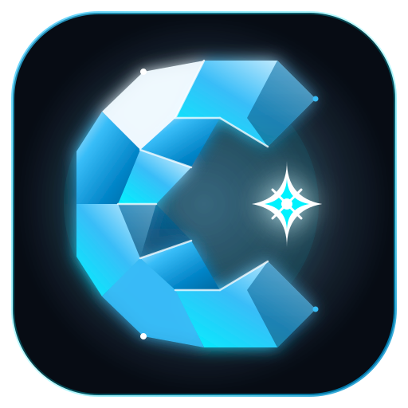

# Carib Code Suite

<div align="center">
  
  <h3>Autonomous Coding & Development Intelligence Platform</h3>
  <p><strong>Sovereign · Free Model Router · Mission Control · Desktop Integration</strong></p>
</div>

---

## ⚡ Overview

**Carib Code Suite** is an enterprise-grade autonomous coding environment engineered by **CARIB GROUP OF COMPANIES LTD**. Designed for maximum developer efficiency, precision, and privacy, Carib Code integrates a responsive web application, local/cloud execution bridges, and an intelligent multi-model router powered by sovereign free foundation models.

### Key Highlights
- **✦ Carib Code Auto**: Zero-cost, high-performance intelligent model router utilizing **Gemini 2.0 Flash**, **DeepSeek R1**, and **Llama 3.3** ($0.00 / prompt).
- **Dual-Mode Workspace**: Live sessions with integrated multi-tab terminal, browser preview viewport, and git diff inspector.
- **Mission Control Dashboard**: Real-time telemetry, model latency benchmarks, and active developer agent orchestration.
- **Privacy & Sovereignty First**: Sovereign authentication, zero third-party vendor lock-in, and strict secret protection.

---

## 🏗️ Architecture & Modules

```
06-Carib-Code-Suite/
├── web-app/                     # Modern responsive coding web interface
│   ├── index.html               # Main application entry point
│   ├── claude_suite.js          # Core UI controller & platform console
│   ├── code_sessions.js         # Session manager, diff renderer & model dispatcher
│   ├── session_ui.js            # Workspace tile layouts (Editor / Terminal / Browser / Diff)
│   ├── code_sessions.css        # Cybernetic dark/light high-contrast theme system
│   └── admin.js                 # Sovereign administration & model configuration
├── mission-control-dashboard/   # Real-time telemetry & agent monitoring
│   ├── app.js                   # Telemetry engine
│   ├── index.html               # Dashboard UI
│   └── server.py                # Local telemetry daemon
├── desktop-apps/                # Native macOS & cross-platform desktop bridges
│   ├── JarvisCockpit/           # Swift native agent controller
│   └── CaribLiveBackstageSuite/ # Backstage synchronization bridge
└── dev-tests/                   # Automated CDP & regression test suites
```

---

## 🧠 Sovereign Model Routing

Carib Code operates on a primary sovereign routing tier that prioritizes verified free upstream endpoints:

| Model Identifier | Display Name | Underlying Architecture | Pricing |
| :--- | :--- | :--- | :--- |
| `carib-code-auto` | **✦ Auto (3 Models)** | Dynamic pool (Gemini 2.0 Flash, DeepSeek R1, Llama 3.3) | **$0.00** |
| `openrouter/free` | **Carib Code Deep** | DeepSeek R1 / V3 Reasoning Chain | **Free** |
| `deepseek/deepseek-r1`| **DeepSeek R1** | Full-depth CoT open-weights reasoning | **Free / Local** |

All requests sent through `/api/code/prompt` are automatically grounded, sanitized, and dispatched through the sovereign gateway without storing or leaking private codebase context.

---

## 🚀 Getting Started

### 1. Launch the Web Application
Serve the `web-app` directory via any standard HTTP server or reverse proxy:

```bash
# Using Python
cd web-app
python3 -m http.server 8080

# Using Node.js
npx serve web-app
```

Open `http://localhost:8080` in any modern web browser.

### 2. Launch Mission Control Dashboard
```bash
cd mission-control-dashboard
python3 server.py
```

### 3. Running Automated Tests
```bash
node dev-tests/run_comprehensive_suite_tests.js
```

---

## 🔒 Security & Governance

- **Zero-Secret Guarantee**: Built and audited under strict repository isolation policies. No production credentials or API keys are committed or transmitted client-side.
- **OWASP Compliant**: Hardened CSP, HSTS, SameSite cookies, and `frame-ancestors` protection.
- **Sovereign Control**: Model routing configuration is managed entirely through `admin.js` and sovereign backend rules.

---

## 📄 License & Attribution

Copyright © 2026 **CARIB GROUP OF COMPANIES LTD**. All rights reserved.  
Part of the **Carib Live Player Suite**.
